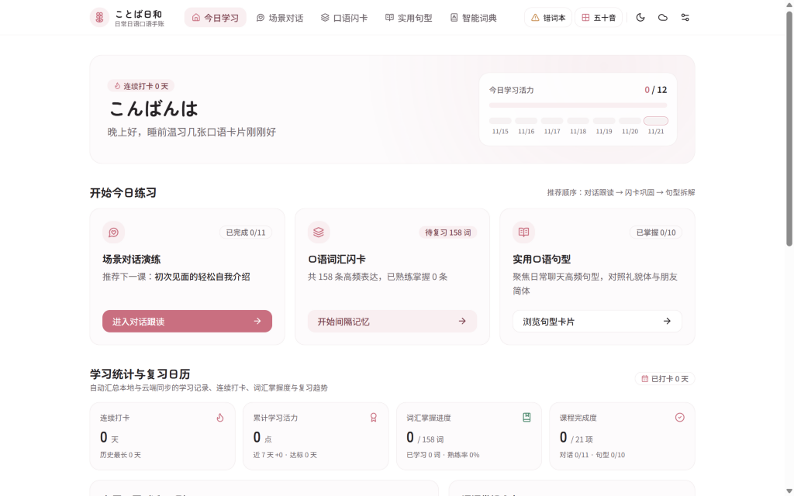
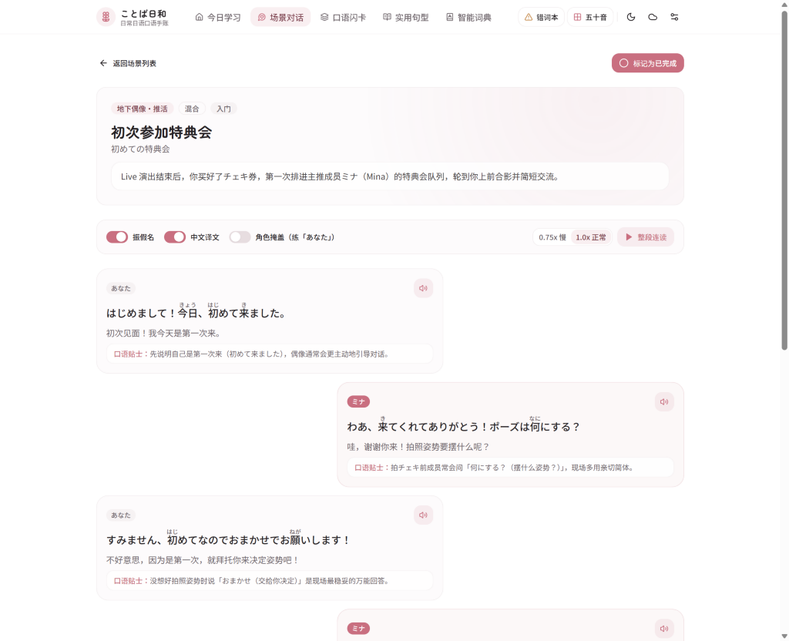
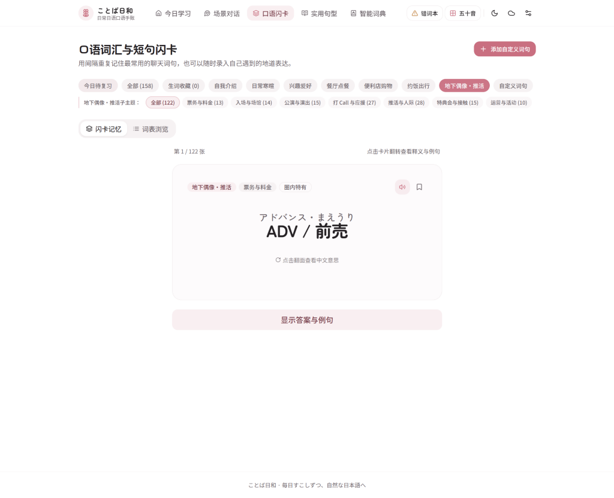
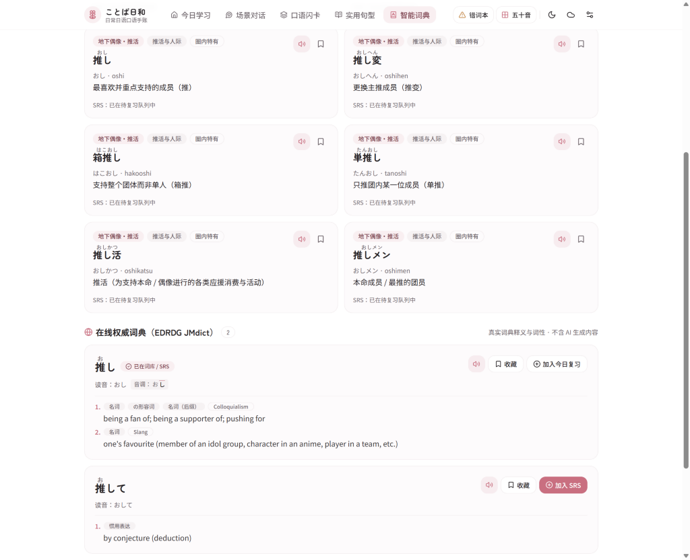

# ことば日和（Kotoba-Biyori）

> 毎日すこしずつ、自然な日本語へ。  
> 一款淡樱日系风的实用日语口语与推活学习应用，集场景对话演练、SRS 口语闪卡、日语智能词典、错词本、学习统计与复习日历及 Supabase 云端同步于一体。

---

## 界面预览

<table>
  <tr>
    <td align="center" width="50%">
      <br />
      <sub><b>今日学习首页 · 打卡活力与学习统计</b></sub>
    </td>
    <td align="center" width="50%">
      <br />
      <sub><b>场景对话演练 · 地下偶像特典会（振假名 / 跟读）</b></sub>
    </td>
  </tr>
  <tr>
    <td align="center" width="50%">
      <br />
      <sub><b>口语词汇闪卡 · 地下偶像・推活与 7 个子主题</b></sub>
    </td>
    <td align="center" width="50%">
      <br />
      <sub><b>日语智能词典 · 本地核验词库 + JMdict / Tatoeba</b></sub>
    </td>
  </tr>
</table>

---

## 核心功能

### 1. 场景对话演练（11 篇完整双人对话）
- **日常聊天（6 篇）**：自我介绍、日常寒暄、兴趣爱好、餐厅点餐、便利店购物、约饭出行。
- **地下偶像・推活（5 篇）**：初次参加特典会、和推し聊天、购买周边与チェキ、参加生誕祭、和日本粉丝交流。
- 支持**汉字振假名（ふりがな）开关**、**中文译文开关**、**罗马音辅助**与**角色掩盖跟读**（隐藏「あなた」台词开口自测）。
- 支持单句朗读、整段连读与语速切换，每篇附带核心表达卡片、礼貌体 / 朋友简体适用说明与日本现场文化贴士。

### 2. 口语词汇与短句闪卡（158 条内置词条 + SRS）
- **日常口语（36 条）**：覆盖 6 大日常交流主题。
- **地下偶像・推活（122 条）**：基于真实词源核验（`genba-ikitai.com` 与 `EDRDG JMdict`），内置 **7 个子主题**（票务与料金、入场与场馆、公演与演出、打 Call 与应援、推活与人际、特典会与接触、运营与活动），标注「圈内特有 / 现场特化 / 演出通用」语域标签，仅收录 Tatoeba 合规真实日语例句，绝不由 AI 编造。
- 内置轻量**间隔重复（SRS）**算法（不认识 / 有点模糊 / 记住了），支持今日待复习、生词收藏、词表搜索及自定义词句录入。

### 3. 日语智能词典
- 支持**日语汉字、假名、罗马音与中文**混合检索。
- **双层真实词源**：本地 158+ 条已核验词库毫秒级离线匹配，同时在线对接 `Jotoba` 开源接口实时获取 **EDRDG JMdict**（读音、真实振假名、词性、音调 Pitch Accent、释义）与 **Tatoeba** 真实语料例句。
- 支持一键语音朗读、**收藏**与**加入 SRS 复习队列**，自动去重并同步至云端。

### 4. 错词本
- 自动收集 SRS 闪卡中标记为「不认识」和「有点模糊」的词汇，按掌握薄弱程度与复习时间排序。
- 支持按程度、主题与关键词筛选，提供**错词清单**与**集中复习**双模式；在集中复习中标记「记住了」即可自动更新 SRS 间隔并移出错词本。

### 5. 学习统计与复习日历（首页集成）
- **核心指标卡**：当前连续打卡天数、历史最长连续天数、累计学习活力、词汇掌握率与课程完成度。
- **近 12 周复习日历热力图**：支持点击任意日期查看当天学习活力、达标状态与复习卡片数。
- **词汇掌握分布与复习趋势**：展示「已熟练 / 巩固中 / 需加强 / 未开始」分布条，支持切换**近 14 天学习趋势柱状图**与**未来 7 天 SRS 复习预报**。

### 6. 实用口语句型与五十音速查
- **实用口语句型（10 组）**：聚焦高频口语句型，支持**礼貌体（です・ます）与朋友简体（タメ口）对照切换**。
- **五十音轻量速查表（104 音）**：覆盖清音、浊音・半浊音、拗音，支持平/片假名对照、罗马音开关与点击发音。

### 7. Supabase 云同步、双主题与数据备份
- **本地优先 + Supabase 云端同步**：未登录时纯本地 LocalStorage 运行；登录后自动将打卡记录、SRS 进度、收藏、错词与自定义词句同步至 Supabase。
- **双主题切换**：淡樱雾粉 × 素白（浅色）与夜樱深灰（深色）一键切换，内置日文字体按需预加载。
- 支持一键**导出 / 导入 JSON 学习数据备份**。

---

## 技术栈与架构

- **框架与构建**：Vite 6 + React 19 + TypeScript + Tailwind CSS v4
- **UI 组件**：基于 Radix UI 底层封装的可控组件源码（`src/components/ui/`）+ `lucide-react` 图标
- **数据与同步**：`src/services/repository/` 抽象 `ILearningRepository` 接口，提供 LocalStorage 本地优先 + Supabase 云同步实现
- **词典与语音**：
  - `src/services/dictionary/`：对接 Jotoba（EDRDG JMdict / Tatoeba）实时检索真实日语词典与例句
  - `src/services/speech/`：抽象 `ISpeechService` 接口，默认使用 Web Speech API（`ja-JP`）

---

## 目录结构

```text
├── supabase/
│   └── schema.sql               # Supabase user_learning_states 表与 RLS 策略
└── src/
    ├── components/
    │   ├── common/              # 振假名渲染、语音朗读按钮、加载/空/错误状态组件
    │   ├── layout/              # 响应式顶栏、移动端底栏、云同步账号与设置弹窗
    │   └── ui/                  # 基于 Radix UI 的可控基础组件源码
    ├── context/                 # AuthContext（账号认证）与 LearningContext（学习状态 / SRS）
    ├── data/                    # 日常与地下偶像场景对话、核验词库、句型与五十音数据
    ├── features/
    │   ├── dashboard/           # 首页仪表盘、学习统计与 12 周复习日历
    │   ├── dialogues/           # 场景对话演练工作室
    │   ├── dictionary/          # 日语智能词典
    │   ├── flashcards/          # 口语词汇闪卡、子主题筛选与自定义词句
    │   ├── grammar/             # 实用口语句型（礼貌体 / 简体对照）
    │   ├── kana/                # 五十音轻量速查表
    │   └── mistakes/            # 错词本与集中复习
    ├── hooks/                   # 轻量 Hash 路由 Hook
    ├── lib/                     # Supabase 客户端、日文字体预加载与日期工具
    ├── services/
    │   ├── dictionary/          # 在线 JMdict / Tatoeba 词典检索服务
    │   ├── repository/          # LocalStorage 与 Supabase 云同步仓储层
    │   └── speech/              # 语音朗读服务
    └── types/                   # TypeScript 领域类型定义
```

---

## 快速开始

### 环境要求
- Node.js >= 20
- pnpm >= 9

### 本地运行

```bash
# 1. 安装依赖
pnpm install

# 2. （可选）配置 Supabase 云同步环境变量
cp .env.example .env.local
# 填入 VITE_SUPABASE_URL 与 VITE_SUPABASE_PUBLISHABLE_KEY，并在 Supabase SQL Editor 执行 supabase/schema.sql

# 3. 启动本地开发服务器
pnpm dev

# 4. 类型检查并构建生产包
pnpm build

# 5. 本地预览生产构建结果
pnpm preview
```
